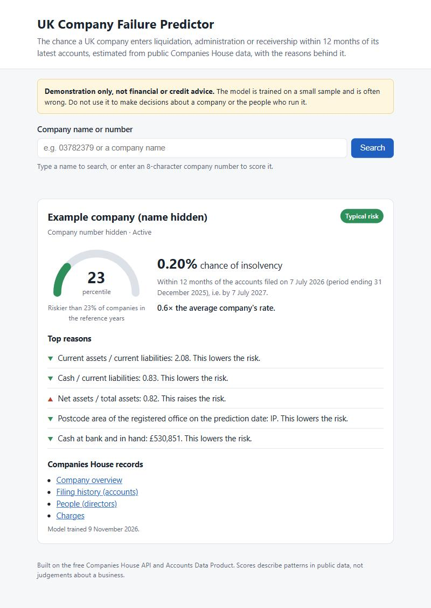
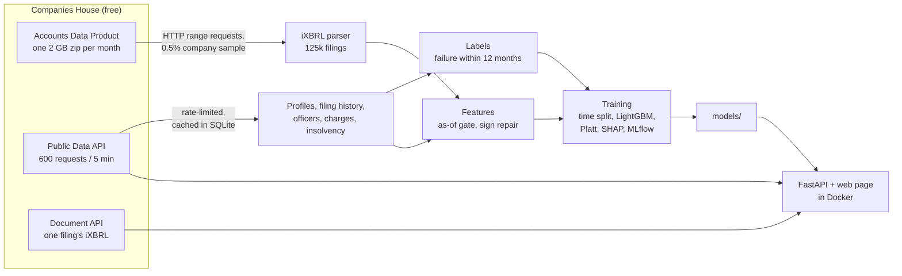

# UK Company Failure Predictor

Type a UK company's name or number and get the estimated chance it enters liquidation,
administration or receivership within 12 months of its latest accounts, the five reasons behind
the score, and links to the Companies House records it came from. Built end to end from free
Companies House data: bulk accounts, the public API, a leakage-tested feature pipeline, a
calibrated model, and a small web app in Docker.

> **Not financial or credit advice.** A portfolio project trained on a small sample; it is
> often wrong. Do not use it to make decisions about a company or the people who run it.



*A real scoring result. The company's name and number are hidden on purpose: a model score next
to an identifiable small business is not something to publish.*

## The problem

About 0.4% of UK companies that file accounts enter formal insolvency in any given year. Companies
House publishes, for free, the accounts of millions of companies plus every filing, director
change and charge. The question: **can those public records, as they stood on the day a company
filed its accounts, say which companies will fail in the next 12 months?**

What makes it hard:

* **Leakage everywhere.** The API returns today's state: today's status, today's address (often
  the liquidator's), resignations that came after the failure. A feature that peeks past the
  filing date makes the model look brilliant and useless. Every feature here is computed as of
  the filing date, and a test proves it.
* **Rare events.** Failures are about 1 in 270 filings, so evaluation needs care: PR-AUC rather
  than accuracy, a time-based split, and confidence intervals.
* **Messy data.** Accounts are iXBRL files tagged by thousands of different software packages,
  with two tagging conventions for the same item and sign errors in both directions (16% of
  filings needed at least one corrected).
* **Rate limits.** 600 API requests per 5 minutes means about 2,100 companies an hour.

## Results

Trained on filings from 2018-2022, calibrated on 2023, tested on 2024-2025 (3,554 randomly
sampled companies, 14,949 filings, 54 failures). Bootstrap 95% intervals:

| Model (test years 2024-2025) | PR-AUC | ROC-AUC | Failures caught in the riskiest 5% | Validation PR-AUC |
|---|---|---|---|---|
| Random ranking | 0.004 | 0.50 | 5% | - |
| Rule: filed late OR negative net assets | 0.006 [0.003, 0.010] | 0.64 [0.51, 0.75] | 0% [0, 26] | 0.006 |
| Logistic regression | 0.010 [0.005, 0.027] | 0.71 [0.61, 0.83] | 13% [0, 33] | 0.012 |
| **LightGBM, class-weighted + Platt** | **0.016** [0.006, 0.060] | **0.74** [0.60, 0.86] | **27%** [6, 50] | **0.024** |

* **A real but modest signal.** The model ranks failures about 4 times better than chance, and
  its riskiest 5% of companies contain about a quarter of the failures. Calibration holds up:
  the riskiest fifth was predicted 1.02% and observed 1.04%.
* **Few failures, wide intervals.** With 15 failures in the test years the intervals overlap;
  LightGBM was chosen on rolling validation (2021-2023), not on the test set.
* **The test set is not pristine.** It was looked at after several data fixes (none chosen by
  test score), so treat the test numbers as somewhat optimistic.
* **What drives scores:** liquidity (current ratio, cash against short-term debts), equity,
  directors' tenure, dormancy and a history of late filing.

Full tables: [reports/metrics.md](reports/metrics.md), [reports/drift.md](reports/drift.md).
Plots: [PR curve](reports/pr_curve.png), [reliability](reports/reliability.png),
[SHAP summary](reports/shap_summary.png). Model card with limits and biases:
[docs/MODEL_CARD.md](docs/MODEL_CARD.md).

## How it works



Five ideas carry the project:

1. **Sample without downloading.** The monthly accounts archives total about 190 GB. Reading
   each zip's directory with HTTP range requests and fetching only a 0.5% company sample cut
   that to 3.6 GB, while keeping every month from 2018 to 2025.
2. **One gate for time.** Every API-based feature passes through a single function that keeps
   only events on or before the filing date. The leakage test rebuilds each row's features from
   a register snapshot taken on that date and demands identical output, on real data from
   Carillion (liquidated in 2018, office moved to the liquidator) and on a synthetic company.
   Breaking the gate on purpose makes it fail.
3. **Honest evaluation.** Split by filing year, never randomly; choices made on validation years
   only; every test metric with an interval; a model card that says what the numbers do not.
4. **Same code in training and serving.** The API fetches a company's latest accounts from the
   Document API and runs the same parser and feature code used in training.
5. **Explanations a person can read.** "Current assets / current liabilities: 0.83. This raises
   the risk.", generated from SHAP values and the same feature descriptions as the docs.

Details and the reasoning behind every choice: [docs/DATA.md](docs/DATA.md) (data, labels,
features) and [docs/DECISIONS.md](docs/DECISIONS.md) (74 decisions, each with its reason).

## Run it

You need [uv](https://docs.astral.sh/uv/), Docker and a free **Live** API key from the
[Companies House developer hub](https://developer.company-information.service.gov.uk/) (a "Test"
key only works against an empty sandbox).

```bash
cp .env.example .env               # add the API key
uv sync
```

**The full pipeline** (each step is resumable and skips work already done):

```bash
uv run python -m cfp.ingest.accounts_download   # ~3.6 GB of range requests, ~30 min
uv run python -m cfp.ingest.accounts_parse      # ~1 h on 8 cores
uv run python -m cfp.ingest.company_data        # optional bulk snapshot, 0.5 GB
uv run python -m cfp.ingest.fetch_companies --keep-awake   # API data, ~2,100 companies/hour
uv run python -m cfp.labels.build_labels
uv run python -m cfp.features.build_features
uv run python -m cfp.train.train                # reports/, models/, MLflow run
uv run python -m cfp.train.drift                # reports/drift.md
```

**The app** (needs `models/` from the training step):

```bash
docker compose up --build          # http://localhost:8000, API docs at /docs
curl -X POST localhost:8000/predict -H "Content-Type: application/json" -d '{"company_number": "03782379"}'
curl "localhost:8000/search?q=carillion"
curl localhost:8000/health
curl localhost:8000/metrics
```

**Checks** (the same as CI):

```bash
uv run ruff check . && uv run ruff format --check . && uv run mypy && uv run pytest
```

**Monthly refresh:** `scripts/refresh.sh 2025-11` adds a month of accounts, updates the API
data, retrains and checks drift. Review the reports before restarting the app on the new model.

## Repository layout

```
src/cfp/ingest/     accounts sampling and parsing, Companies House API client, bulk snapshot
src/cfp/labels/     insolvency labels per filing
src/cfp/features/   point-in-time features (financial, filings, officers, charges, profile)
src/cfp/train/      split, models, evaluation, calibration, SHAP, drift
src/cfp/serve/      FastAPI app and live scoring
app/                web page (HTML, CSS, JavaScript)
tests/              118 tests; fixtures are real Companies House responses
reports/            metrics, plots, drift report (committed as evidence)
docs/               DEVELOPER_GUIDE.md, DATA.md, MODEL_CARD.md, DECISIONS.md
```

New to the code? Start with the [developer guide](docs/DEVELOPER_GUIDE.md): setup, the
pipeline, the code map, the rules that keep the model honest, common tasks and known gotchas.

## Limits

* **30 failures to learn from.** By far the biggest limit; results will move with more data.
* **Small companies say little.** Most file micro-entity accounts with a few balance-sheet lines
  and no profit and loss, so the model leans on balance sheets and filing behaviour.
* **Postcode area matters more than it should**, likely partly overfitting and a possible source
  of regional bias.
* **Only electronic filings, only formal insolvency.** Paper filers are missing, and most small
  companies that stop trading are struck off rather than becoming insolvent.

More in the [model card](docs/MODEL_CARD.md).

## What went wrong (and what it taught me)

* **The first API key was for the sandbox.** Every real company returned 401. Companies House's
  "Test" environment is a separate, mostly empty register; a "Live" key is free and is what a
  read-only project needs.
* **Laptop sleep cost a day.** Long jobs paused overnight, and the API fetch finally died at
  3,556 of 29,584 companies on an overloaded machine. Fixes: work in random order so a partial
  fetch is still a fair sample, make every step resumable, run long jobs as separate processes,
  and ask Windows to stay awake. The rate limit (about 14 hours for the full sample) made
  "build on what we have" the practical choice, at the cost of having only 54 failures.
* **iXBRL is messier than the spec suggests.** Checking the parsed data against tag counts found:
  * a second tagging convention for "due within one year" (coverage 35% → 74% once handled);
  * one software vendor stamping `OriginalRevisedDataDimension` on every fact, hiding all values
    in 5.6% of 2023 filings;
  * sign errors in both directions: negatives shown in brackets but tagged positive, and
    creditors (even employee counts) tagged negative because they are shown in brackets.

  The last of these turned up only when a README screenshot showed negative current assets, and
  fixing it doubled the test PR-AUC.
* **"Today's state" leaks in subtle ways.** Liquidators move the registered office to their own
  office, so today's address points straight at failed companies. The feature now reconstructs
  the address as of the filing date, and the leakage test fails if it ever uses today's.
* **Labels needed more care than expected.** Members' voluntary liquidations are *solvent*
  wind-downs, not failures. Companies rescued from administration years ago were at first
  wrongly excluded as "already insolvent".
* **The model memorised categories.** The first LightGBM leaned on fine-grained industry codes
  and postcodes and looked great on validation but not on test. Coarser SIC sections and
  stronger categorical smoothing helped.
* **Drift is often the data, not the world.** The drift check's two biggest "shifts" were a
  2023 taxonomy change (a new `FilletedAccounts` label for the same accounts) and 29 February
  2024 changing period lengths by a day. Both were feature-design bugs, now fixed.
* **Small bugs that tests caught:** `Retry-After: 0` treated as "no header" (a 60-second wait);
  polars evaluating expressions in one `with_columns` call in parallel, so a fill-null wasn't
  seen by the next expression; a CSS `display` rule overriding the `hidden` attribute; a
  PowerShell UTF-8 byte-order mark that silently broke `pyproject.toml` for mypy.
* **Serving surprises.** Large groups (Tesco, Greggs) file PDF-only accounts and have thousands
  of filings; paging through them all before discovering the PDF took 20 seconds. Checking the
  latest accounts first cut it to under 1 second.

## What I would do next

* Finish the API fetch (or use the built-in `--skip-active` shortcut for labels) to get roughly
  8 times more failures, then re-evaluate on a year the model has never seen.
* Replace postcode area with broader regions, and test for regional and sector bias.
* Model the second label (strike-off), which is far more common than formal insolvency.
* Prometheus metrics, a Docker build in CI, and scheduled monthly refreshes.

## Data and licence

Contains public sector information licensed under the
[Open Government Licence v3.0](https://www.nationalarchives.gov.uk/doc/open-government-licence/version/3/).
Data from Companies House; this project is not affiliated with or endorsed by Companies House.
